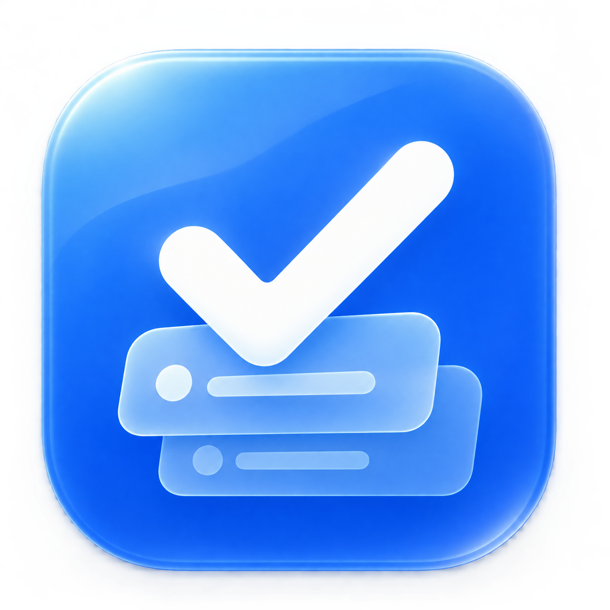
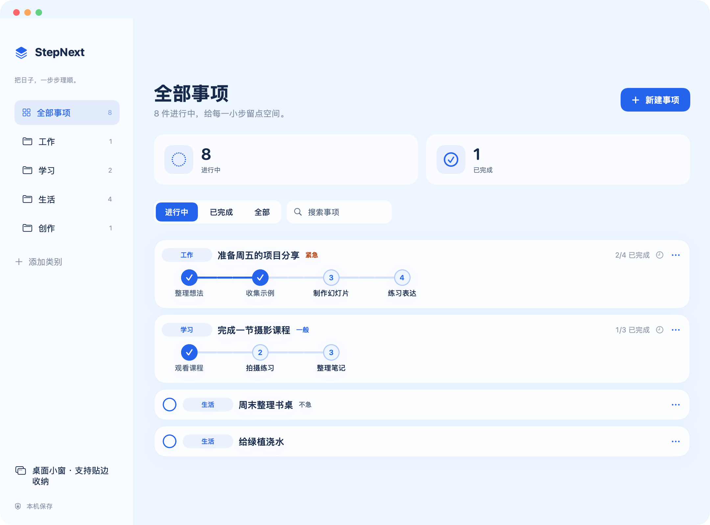
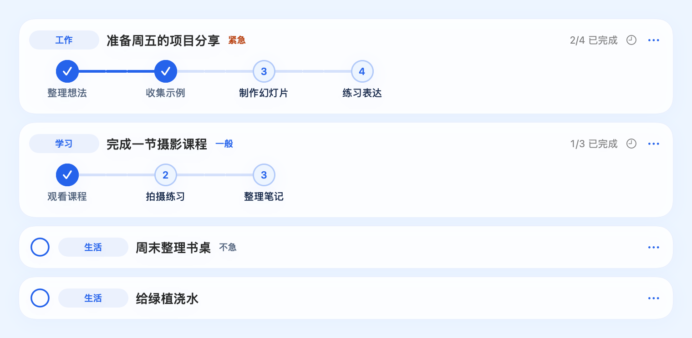
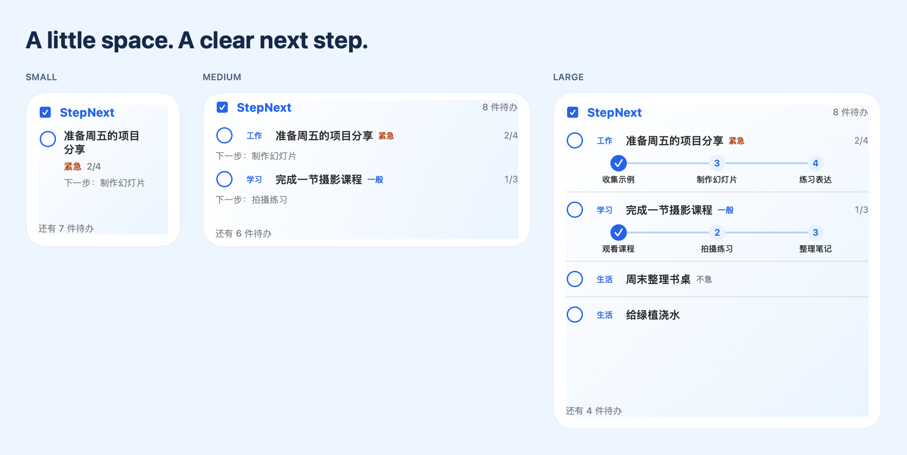
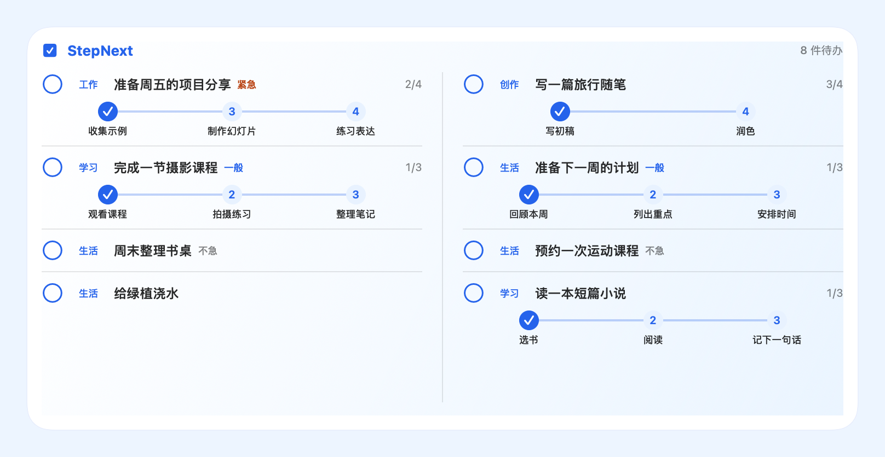

<p align="center">
  
</p>
<h1 align="center">StepNext</h1>
<p align="center"><strong>One step closer.</strong></p>
<p align="center">A quiet home for your tasks. Clear progress, right on your Mac desktop.</p>
<p align="center">
  <a href="https://github.com/D2Simon/StepNext/releases">Download</a> ·
  <a href="#install">Install</a> ·
  <a href="README.zh-CN.md">简体中文</a> ·
  <a href="LICENSE">MIT License</a>
</p>

StepNext（拾序）is a native macOS to-do and progress manager with a blue-and-white glass interface, interactive desktop widgets, and an optional floating window. Keep a task simple, or break it into a few visible steps.



*All previews use fictional demo records. Images are rendered from the app's views; system menus and scrolling containers use a static presentation. No personal tasks, accounts, or desktop screenshots are included.*

## Install

**No Xcode or developer account is needed to install a prebuilt release.** On an Apple Silicon Mac running macOS 14 or later:

```bash
curl -fsSL https://raw.githubusercontent.com/D2Simon/StepNext/main/install.sh -o install.sh
bash install.sh
```

Already downloaded or cloned this repository? Just run:

```bash
bash install.sh
```

The [installer](install.sh) downloads the newest compatible GitHub Release, checks its SHA-256 checksum and code-signature integrity, installs `StepNext.app`, and registers its widget extension. It uses `/Applications` when writable, otherwise `~/Applications`. It preserves task data and keeps a backup of the previous application when updating. Quit StepNext before updating.

Then **right-click the desktop → Edit Widgets → search “StepNext”**. Add the size you like. You can use the widget while the main app is closed; open the app to add or edit tasks.

Prefer manual installation? Download an app ZIP from [Releases](https://github.com/D2Simon/StepNext/releases), unzip it, and drag `StepNext.app` into Applications.

> **Current release: unnotarized test build.** The installer does not remove quarantine flags or disable Gatekeeper. macOS may block opening the app. A SHA-256 checksum and an ad-hoc signature are not Apple notarization. See [installation notes](docs/INSTALL.zh-CN.md). Installing Xcode is only needed if you choose to build from source.

## Small tasks, visible progress



- **One-line tasks.** Write a title and save. Click the circle when you're done.
- **Two-line step cards.** Category, title, priority and completion count stay together; the connected steps sit underneath.
- **Optional priority.** None, urgent, normal, or low. Priorities are labels and do not automatically reorder tasks.
- **Flexible deadlines.** Choose a date, write “this weekend,” or leave it blank. Text deadlines are not automatically parsed.
- **Your own categories.** Start with Work, Learning and Life, or add categories you can reuse.
- **Local by default.** No account, sync service, analytics or third-party runtime dependency.

### Progress follows your last choice

Click a step to set how far you've completed—not just to toggle that one checkbox.

| Action | Result |
| --- | --- |
| Click step 3 | Steps 1–3 are complete; later steps are cleared |
| Then click step 2 | Only steps 1–2 remain complete |
| Click step 2 again | Progress stays at step 2 |
| Only step 1 is complete; click step 1 again | Return to not started |
| Click the final step | The whole task is complete and leaves the pending list |

A simple, single-step task completes directly. There is no timed undo banner after an entire task is completed.

## On your desktop



| Widget | What it shows | Up to |
| --- | --- | --- |
| Small | One focus task and a short progress summary | 1 task |
| Medium | A brief task list | 2 tasks |
| Large | Connected steps for each task | 4 tasks |
| Extra large, landscape | Two columns with detailed progress | 8 tasks |
| Extra large, portrait | A longer detailed list; macOS 27+ | 8 tasks |



Actual space depends on system size, text length and widget appearance. Longer step lists show up to four nodes around the current position; the full list remains in the app. Widgets show a remaining-task count instead of scrolling.

There is also a separate **floating desktop window**. Drag it to the left or right edge, move the pointer away to tuck it in, and hover over the exposed edge to reveal it. This edge behavior belongs to the floating window; native WidgetKit widgets use macOS's own placement and sizes.

## Build and contribute

The current interface is in Chinese; task titles and category names can use any language.

| | Requirement |
| --- | --- |
| Prebuilt application | Apple Silicon, macOS 14+ deployment target |
| Tested locally | macOS 27.0, Xcode 27.2 |
| Source build | Full Xcode 27+; complete its first-launch setup |
| Intel package | Not currently provided |

```bash
./scripts/test.sh
./scripts/build.sh
./scripts/package.sh
```

The raw development build is `dist/拾序.app`; the distributable ZIP contains `StepNext.app`. Build caches and distribution files are ignored by Git. Local builds use ad-hoc signing and don't require a paid developer account. Developer ID signing and notarization are separate maintainer steps—see [Releasing](docs/RELEASING.md).

[Testing scope](docs/TESTING.md) · [GitHub publishing guide](docs/GITHUB.md) · [Changelog](CHANGELOG.md)

## Privacy and demo data

The app saves tasks on your own Mac. The installer contacts GitHub only to obtain release metadata, the application and its checksum; it never reads or uploads task data.

The demo records live in [Demo/DemoData.swift](Demo/DemoData.swift), separate from the application target. They are **not imported into an installed app**, and documentation rendering uses an isolated store. To regenerate previews, a developer can run:

```bash
python3 scripts/render-docs.py
```

Task storage uses a stable internal identifier retained for compatibility:

```text
~/Library/Containers/local.shixu.app.widget/Data/Library/Application Support/Shixu/tasks.json
```

A neighboring `tasks.json.backup` keeps the previous saved version. Back up this folder before manual migrations. The host app is not sandboxed; the widget extension is sandboxed and the host uses the extension's container for local sharing. Neither repository files nor release packages contain the author's task database or signing credentials.

Current limitations: no cloud sync, deadline notifications, automatic updater, or complete English UI localization. Other Macs and older supported macOS releases still need broader testing.

## License

[MIT](LICENSE) © StepNext contributors. See [asset and dependency notices](THIRD_PARTY_NOTICES.md).
