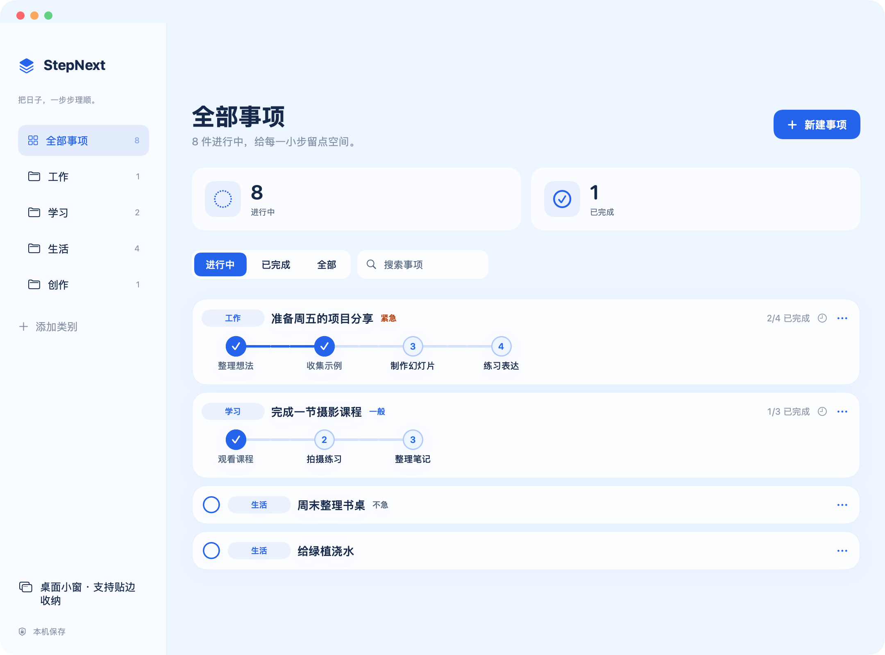
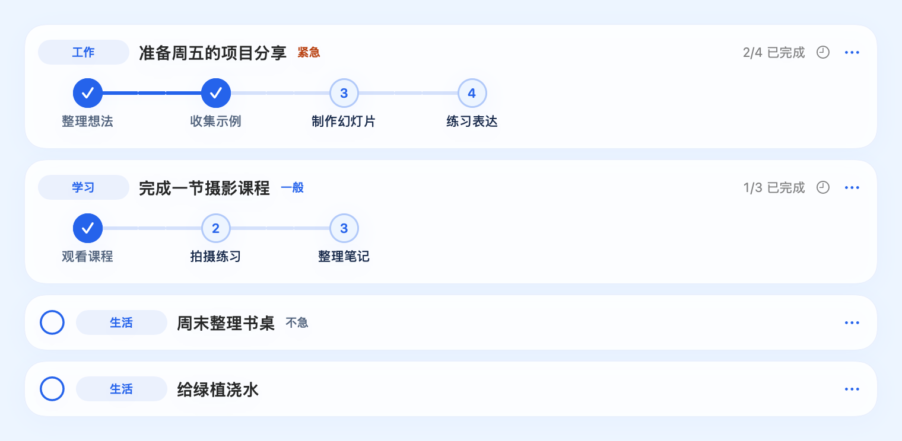
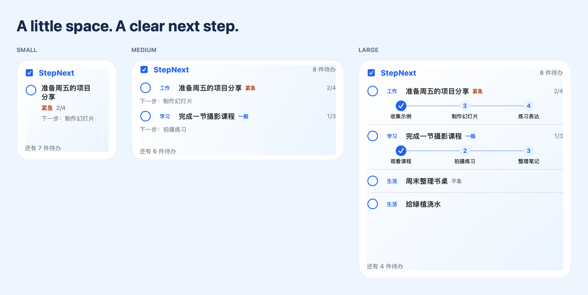
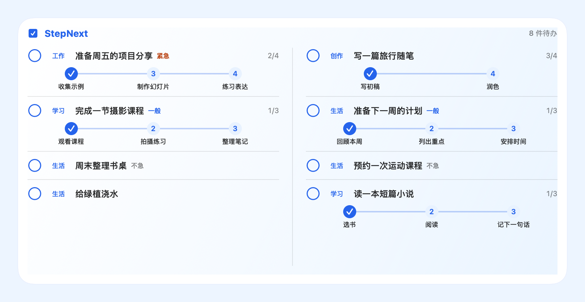

<p align="center"></p>
<h1 align="center">StepNext · 拾序</h1>
<p align="center"><strong>One step closer. 每一步，都更近一点。</strong></p>
<p align="center"><a href="https://github.com/D2Simon/StepNext/releases">下载应用</a> · <a href="README.md">English</a> · <a href="LICENSE">MIT 许可</a></p>

一个原生 macOS 待办与进度管理应用。蓝白玻璃界面，事项紧凑排列，进度直接放在桌面上。



> 展示图全部使用独立的虚构事项，由应用组件离屏渲染；系统菜单和滚动容器使用静态展示，不含真实待办、账号或桌面截图。

## 一键安装

**安装成品不需要 Xcode，也不需要开发者账号。** Apple Silicon Mac、macOS 14 或以上，在终端运行：

```bash
curl -fsSL https://raw.githubusercontent.com/D2Simon/StepNext/main/install.sh -o install.sh
bash install.sh
```

如果已经下载或克隆了本仓库，进入目录后只需：

```bash
bash install.sh
```

脚本会从 [D2Simon/StepNext 的 Releases](https://github.com/D2Simon/StepNext/releases) 下载最新兼容版本，核对 SHA-256 和代码签名完整性，安装到“应用程序”并登记桌面小组件。无系统应用目录写权限时使用个人的 `~/Applications`，不自动调用 sudo。

更新时再次运行同一命令。请先退出 StepNext；脚本保留上一版应用，不删除、不上传待办数据。

安装后，右键桌面空白处 → **编辑小组件** → 搜索 **StepNext** → 添加合适的尺寸。

也可以手动下载 Release 中的应用 ZIP，解压后把 `StepNext.app` 拖入“应用程序”，打开一次。

> 当前是**尚未 Apple 公证的测试版**。macOS 可能拦截打开；安装脚本不会移除隔离标记或关闭系统安全保护。校验和与临时签名不等于 Apple 公证。需要正式签名版本时请关注后续 Release；仅自行编译源码时才需要 Xcode。详见[安装说明](docs/INSTALL.zh-CN.md)。

## 事项更简单，进度更清楚



- **单项只占一行**：填名称即可保存，点圆圈完成。
- **多步骤只占两行**：第一行是分类、事项、优先级、完成数；第二行是横向步骤。
- **优先级可不设**：紧急、一般、不急，也可以留空。优先级作为标记，不自动重排事项。
- **DDL 不必是日期**：具体日期、一句话或留空。文字不会自动解析，也没有到期通知。
- **分类自己定**：预设工作、学习、生活，新增类别以后可以重复使用。
- **完全本地保存**：不用注册账号，没有云同步或遥测。

### 点击节点，覆盖当前进度

| 你的操作 | 得到的进度 |
| --- | --- |
| 点步骤 3 | 前 3 步完成，后面清空 |
| 再点步骤 2 | 退回到前 2 步完成 |
| 再点步骤 2 | 保持完成到第 2 步 |
| 当前只完成第 1 步，再点第 1 步 | 回到未开始 |
| 点最后一步 | 整件事完成，移出待办 |

默认单项事项直接完成；整件事完成后不显示限时撤销入口。

## 放在桌面上



| 尺寸 | 显示内容 | 最多显示 |
| --- | --- | --- |
| 小号 | 重点事项和简要进度 | 1 件 |
| 中号 | 简要待办列表 | 2 件 |
| 大号 | 每件事的横向步骤 | 4 件 |
| 横向超大号 | 双栏详细进度 | 8 件 |
| 纵向超大号 | 长清单详细进度，macOS 27+ | 8 件 |



小组件中的进度可以直接点击，主 App 不必一直打开。新增、编辑及查看已完成事项时再打开主 App。实际空间受系统尺寸和文字长度影响；长步骤列表围绕当前位置展示最多 4 个节点，完整内容在主 App 中查看。

另外还有独立的**桌面悬浮小窗**：拖到左右边缘后，鼠标移开自动收起，移到露出的窄边再展开。系统 WidgetKit 小组件由 macOS 管理位置和尺寸，不使用这个贴边行为。

## 从源码构建

需要完整 Xcode 27 或以上，先完成首次启动初始化和许可协议确认。当前在 macOS 27.0、Xcode 27.2 上测试；最低部署目标为 macOS 14，尚未覆盖所有旧版本的实机验证。当前没有 Intel 成品。

```bash
./scripts/test.sh
./scripts/build.sh
./scripts/package.sh
```

开发构建位于 `dist/拾序.app`，发布 ZIP 内的应用名称为 `StepNext.app`。默认使用本机临时签名，不要求付费开发者账号。正式分发签名和公证步骤见[发布指南](docs/RELEASING.md)。

## 隐私与示范数据

所有展示数据都来自 [Demo/DemoData.swift](Demo/DemoData.swift)，不编译进应用，也不会导入真实数据目录。开发者可运行 `python3 scripts/render-docs.py` 重新生成预览。

App 数据只在使用者自己的 Mac 上。安装脚本仅向 GitHub 请求 Release 和安装文件，不读取或上传待办。

出于兼容性，内部数据标识仍保留为：

```text
~/Library/Containers/local.shixu.app.widget/Data/Library/Application Support/Shixu/tasks.json
```

相邻 `tasks.json.backup` 保留上一版数据。手动迁移前请备份。主 App 不启用沙盒，扩展启用沙盒，通过扩展容器共享数据。

当前没有云同步、到期通知、自动更新或完整英文界面。[测试范围](docs/TESTING.md) · [更新记录](CHANGELOG.md)

## 许可

采用 [MIT License](LICENSE)。[素材与依赖说明](THIRD_PARTY_NOTICES.md)。
